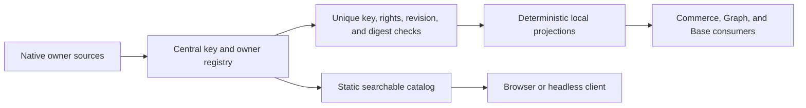

# Agentic Design System — Shared Ownership and Singleton Tokens

**Join:** `DESIGN-TOKEN-ADOPTION-001@0.3.0`, superseding `0.2.0`. This revision makes the design-system repository the single registry and eventual editable value owner for the four-repository design surface. It replaces the earlier Commerce-only boundary with one owner map, one canonical key space, and generated, revision-pinned consumer projections. Native component behavior remains with its product owner. Source rights, migration status, and runtime adoption are separate facts; none is claimed complete by this plan.

**Change boundary:** this PRD-only change establishes the plan required for a later scoped implementation lane. It does not modify product consumers, transfer source rights, release catalog records, or deploy the static site.

## Codebase grounding record

Facts below were read from each exact `main` commit object, not inferred from another repository's working tree. File digests bind the inspected bytes; they are not permission or adoption receipts.

| Repository and revision | Exact source | Current owner and boundary | Evidence / consequence |
|---|---|---|---|
| `agentic-os` · `38ad20d148c126902d5d54a9a00ea61360b5ca77` | `guides/SYSTEM-PROMPT-RUNTIME.md` · SHA-256 `c244e81743133adf44cd831f77bdfabf8e9487b2c043a66f45afd474c8bf421d` | Runtime policy, lane admission, and release governance. It is not a visual-token source. | Keep governance and receipts with this owner; do not add product token values here. |
| `agentic-commerce-os` · `6ce3bc918717b97a738ac831dfb4fb3319a02fb6` | `public/local-first/workspace-shell.css` · SHA-256 `2e0b86c0efa040618b8cbfab9d130a751ab85e7d937f94762b8d523a5920f100`; `public/local-first/index.html` · SHA-256 `bff3aefecb745a23388b6a4cc85dd5ea285e84b8fb68dc18fe4619dcbe3d6429` | Commerce owns shell behavior, product state, and view-specific implementation. | Preserve the existing product owner and migrate only through a Commerce-scoped lane. |
| `agentic-graph` · `c549f48ccbb78912781df2b6b47ff37df4c5ae81` | `grph-shared/src/ui/kgTokens.ts` · SHA-256 `4a8e7e57e011f986cc86d94f5d77d43cea26660627677cd5c0f4ab7fd25bc30e`; generated `canvas/src/styles/kgTokens.generated.css` · SHA-256 `b676d411f7f1683a9b208b2a74f03a921d7e77a32a6f2b4a4274a41c6441dee8` | Graph owns its current graph-token source; the CSS file is a generated projection, not a second editable owner. | No values or assets move until the Graph owner and reuse rights are verified. |
| `agentic-base` · `a5d0f2d87d8c6871e9639f8224f5eaee056c5b6e` | `packages/views-react/src/browser/browserDataView.css` · SHA-256 `f00b3f4c88dfa81946fdc1577aa01ff49ea3e6f996f32607bc715a5d93079b69` | Base owns shared data-view presentation and component behavior. | Reuse its exact contract; do not copy its component or stylesheet into this repository. |
| `agentic-design-system` · `87bef83404065a5de7a1e8a2b3159589984932d8` | `site/tokens/commerce-profile.json` · SHA-256 `000adeb267d0d0ff9527e1227faefcd5fd2c15faee463fa70173204783ea7c9e`; `scripts/commerce-profile.mjs` | This repository owns the catalog, Commerce profile, token contracts, and deterministic projections. | The Commerce profile has 36 unique candidate tokens; the public catalog is draft and empty. Neither fact proves cross-product adoption. |

The existing joined plan `DESIGN-TOKEN-ADOPTION-001@0.2.0` is the predecessor, not a parallel active plan. Its source is the pinned `parent` above. The current plan's owner is this repository. A consumer plan or README may link here but may not restate token rules or create another authoritative registry.

## PRD

### Customer, pain, and evidence

**P1 — observed, not yet measured:** contributors lose time locating the owning token or style source across repositories. Repeated values and consumer overrides can drift, but time loss, defect rate, buyer impact, and willingness to pay have not been measured. Repository inspection confirms multiple native owners and generated files; it does not establish the number of duplicates or a customer outcome.

| Role | Job | Evidence state |
|---|---|---|
| Product contributor | Find one owner, key, and revision before changing a UI surface. | Intended user; interviews not run. |
| Source maintainer | Keep owned values consistent with the central registry and generated pin. | Owners observed; migration authority and rights remain to be verified. |
| Reviewer | See duplicate, override, rights, and compatibility gaps before release. | Existing checks cover only parts of this contract. |
| Buyer | Reduce recurring integration and review effort. | Buyer and willingness to pay are unknown. |

### Journey and scope

| Stage | User action | Desired result | Failure prevented |
|---|---|---|---|
| Need | Change a visual or interaction surface. | Resolve the canonical key and owning repository. | Copying a nearby value or choosing a stale variant. |
| Discover | Search the local catalog with plain text, `@owner`, or `#scope`. | One owner, source revision, digest, status, and consumer pin. | Duplicate records and mutable `latest` references. |
| Verify | Inspect source, rights, compatibility, and checks. | Pass, explicit gap, or blocked state. | Treating a screenshot, link, or generated file as source authority. |
| Adopt | Pin the owner and consume a deterministic local projection. | No runtime fetch and no second editable value. | Consumer override, duplicate stylesheet, or hidden cascade. |
| Maintain | Update the owner and regenerate consumers. | One reviewed successor with an exact predecessor. | Silent drift and competing registries. |

**Must:** one central owner registry; unique canonical keys; one editable design-system source per rights-cleared key and mode; exact source revision and digest; explicit rights and migration state; deterministic read-only projections; consumer pins and rollback targets; a fail-closed duplicate/override check; static, local, mobile, and offline discovery. The target state is that Commerce, Graph, and Base hold generated projections or contract-only adapters, not independent editable values. Rights-blocked inputs remain marked blocked and are not claimed centralized. The registry also records Agentic OS policy ownership; Agentic OS is not assigned visual tokens.

**Should:** local search by owner, concern, token key, and repository; copyable exact pins; drift status. **Could:** an opt-in preview from authorized sources. **Won't:** a second token source, consumer-authored overrides for registered keys, runtime network dependency, model calls, telemetry, account system, paid plan/add-on/overage, copied private components/assets, or a public rights claim inferred from repository visibility.

### Acceptance criteria

| VCC | Given / when / then | Named check | Constraint |
|---|---|---|---|
| DS-01 | A registry entry is loaded; it resolves to one canonical key, one owner, one source path, one immutable revision, and one digest or it is blocked. | `design-owner-registry-check` | Unknown ownership never defaults to a fallback source. |
| DS-02 | Two entries or declarations claim the same key or CSS variable; validation fails with both locations. | `design-singleton-enforcement-check` | Identical duplicate values also fail; no silent deduplication. |
| DS-03 | A consumer projection is generated from a pinned source; repeated generation is byte-stable and stale or hand-edited output fails. | `design-generated-output-check` | Generated outputs are read-only projections, never owners. |
| DS-04 | A consumer declares a different value for a registered key; the build rejects the override, including cascade-based overrides in the token layer. | `design-singleton-enforcement-check` | A new semantic key needs an owner and recorded decision; it cannot shadow an existing key. |
| DS-05 | A source has unknown or restricted reuse rights; it is visible as a blocked owner reference and no source value or asset is copied or publicly released. | `design-license-boundary-check` | Repository visibility is not a license. |
| DS-06 | The static catalog is opened on a clean 320px browser, then after cache priming without network; search and navigation remain usable. | `design-site-browser-check` | Local assets only; no CDN, remote font, telemetry, or runtime model call. |
| DS-07 | A reviewer checks keyboard, visible focus, contrast, 200% zoom, reduced motion, and narrow touch layouts; each has evidence or a named gap. | `design-accessibility-evidence-check` | A visual snapshot alone cannot pass behavior. |
| DS-08 | A consumer pin is rolled back; its prior exact revision and digest restore without deleting source history. | `design-rollback-check` | Rollback remains a consumer-owned operation with a separate receipt. |
| DS-09 | A contributor runs `npm run dev`; the local UI loads at the printed loopback URL and its network log shows no external requests. | `design-site-browser-check` | Dependency-free local server; no production deploy. |
| DS-10 | A machine client reads the same static registry as the browser; `/` sections, `#scope`, and `@owner` resolve to that record. | `design-catalog-contract-check` | No parallel MCP/WebMCP data source; optional transports consume this contract only. |

The static JSON contract is the headless interface for this MVP. MCP/WebMCP adapters are deferred until an actual consumer needs them and can reuse the same contract without a service, duplicate registry, or additional cost. `spec-complete` describes this plan only; no VCC is claimed passed.

### Outcomes and economics

| Measure | Baseline | Target |
|---|---|---|
| Resolve owner, revision, and status | Unknown; time five contributor tasks before baseline. | Median ≤5 minutes in a five-task pilot; report misses and correction loops. |
| Duplicate registered keys or token-layer overrides | Cross-repository inventory incomplete. | Zero unresolved duplicates or overrides in the declared candidate; do not claim whole-repository parity until every consumer is scanned. |
| Consumer pin coverage | Exact coverage not measured. | Every declared consumer points to one source revision and digest, or has an explicit blocked state. |
| Incremental spend / model use | Not attributable to this plan. | $0 spend and 0 product model calls/tokens. Unknown costs block an effect. |
| Time-to-value / savings | Unmeasured. | Report elapsed time and corrections; no savings claim before a comparable baseline. |

The first-dollar path to validate is a voluntary one-time US$1 sponsorship with no feature gate or recurring charge. No payment flow, outreach, paid plan, add-on, or overage is in the MVP; no collected revenue is claimed. Product and registry remain FOSS/free. Hosting allocation and labor cost remain unknown until measured.

### Market, offer, and alternatives

Initial segment hypothesis: small product teams maintaining browser interfaces across several repositories. The reachable buyer count, sales cycle, repeat demand, and price are unknown. The free/manual alternative is repository search and owner documentation; the FOSS alternative is a local schema and duplicate check. The MVP improves that workflow without a hosted service. Do not publish a monetary market estimate or forecast until segment fit and collected-price evidence exist.

## TAD

### Ownership and interfaces

| Concern | Authoritative owner | Consumer contract |
|---|---|---|
| Lifecycle policy, source admission, and release evidence | Agentic OS | Consumers reference its current policy; product design data stays out of this repository. |
| Shared design semantics, canonical keys, owner map, rights state, versioning | Agentic Design System | One record per key and mode; immutable owner revision and digest. |
| Commerce theme values | Agentic Design System `site/tokens/commerce-profile.json` | Existing generator emits the pinned local projection; Commerce behavior remains Commerce-owned. |
| Graph theme values | Current Graph source until an owner-approved migration | Graph consumers use one generated projection; current native source is not copied or dual-owned. |
| Base data-view values and component behavior | Base source until an owner-approved migration | Consumers use the exact Base pin; no competing renderer or copied component implementation. |
| Browser behavior, data state, and product content | Each product repository | Keep native component APIs and state; consume design tokens through one adapter. |
| Generated CSS and local indexes | Generator bound to the central registry and exact source pins | Read-only output with reproducible digest; edits fail validation. |

**Registry record:** stable key; semantic scope; mode set; one owner repository/path; immutable revision; source digest; rights state; migration state; generated consumer paths and digests; compatibility; rollback pin; named checks. A key may have explicit mode values in one record, but no alternate file or cascade override. Product-specific concerns use new, non-overlapping keys and cannot redefine a shared key. An unresolved owner or rights state blocks publication and adoption.

### Data and invocation flow

The catalog reads local JSON. Consumers pin static generated files and do not fetch the registry at runtime. User-facing search supports plain text, `@owner`, and `#scope`; `/` remains section navigation. Optional MCP/WebMCP transport is not part of this MVP.

### Quality, security, and operation

The site must reflow at 320, 360, 768, and 1280 CSS px without page-level horizontal overflow. Interactive targets are at least 44 CSS px; text contrast is at least 4.5:1 (large text 3:1), and control/focus contrast is at least 3:1. Keyboard use, focus visibility, reduced motion, 200% zoom, offline after cache priming, and local fallback fonts require named evidence. These are acceptance targets, not current pass claims.

Threats are duplicate keys, poisoned or stale owner metadata, digest drift, cascade overrides, rights leakage, incompatible projection, and a false rollback. Validate bounded JSON, render text safely, reject unknown fields, keep private/restricted content out of the public payload, and preserve a verified predecessor. The site has no user accounts, remote data service, analytics, or model calls.

**Budgets:** $0 incremental external spend; no paid dependency or model token; ≤25 changed paths across the plan's first implementation slice; ≤100 kB incremental shipped bytes; ≤3 new runtime modules; each file under 600 lines; one owner registry, one validator, one generator path. Stop at a cap and revise the plan before widening scope. External waits are blockers with an owner and recheck condition, not an ETA.

## ADR-01 — Central registry, native source owners, generated consumers

**Status:** proposed. **Decision:** make this repository the sole registry and, after rights-cleared migration, the sole editable value owner for adopted visual tokens across the product repositories. A migration records the current source as provenance, moves the value into the central source, and removes the old editable definition in the same owner-reviewed adoption. Generated consumer files are projections only. No product can override a registered key. If source rights or owner approval blocks transfer, keep one native source, mark the key blocked, and do not claim the centralization is complete.

**Alternatives:** leave four unindexed registries (retains discovery and drift pain); copy all values into the public catalog immediately (rights and exposure not established); impose one global palette without a mapped semantic owner (collapses product meaning). The chosen path centralizes governance now and migrates values only when owner and rights evidence permit it.

**Consequences:** duplicate definitions fail closed; product adapters may remain only as contract-only shims; a consumer migration is incomplete until the prior editable value is removed and generated pin is verified. Restricted values stay native and are represented only by a non-sensitive blocked reference.

## MVP

**Plan-bound first slice:** add the central ownership/key contract, source map for the four repositories, fail-closed uniqueness and override checks, a polished local search and ownership view, and a dependency-free `npm run dev` loopback server. Keep catalog release status draft until rights and evidence are complete. Consumer migrations are sequenced by owner and exact lane; this first slice does not edit the four consumer repositories.

| VCC set | Evidence | Local rung | Delivered rung |
|---|---|---|---|
| DS-01–DS-10 | Specified; implementation and browser evidence not yet produced. | spec-complete | undocumented |

**Demo:** search a canonical key → inspect its one owner, revision, rights, and consumer pins → show a duplicate or override as blocked → follow the local predecessor pin. Target ≤3 minutes; timed pilot not run.

### Roadmap

| Phase | Rank / reuse | Exit | Stop and recovery |
|---|---|---|---|
| A · registry baseline | P1, unvalidated; reuse the existing static catalog and Commerce profile. | Exact owner inventory, rights states, unique keys, and check fixtures. | Stop if ownership or rights cannot be verified; publish no values. |
| B · central contract and UI | Reuse existing local assets, schema, and search. | DS-01/02/05/06/09/10; local/mobile/offline evidence; $0 and no new runtime dependency. | Keep catalog draft; revert the exact candidate if checks fail. |
| C · consumer projections | Reuse each native generator and owner workflow. | One generated pin per consumer, prior editable duplicates removed, DS-03/04/08. | Stop in that consumer lane; restore its exact prior pin. |
| D · accessibility and value | Reuse browser and accessibility evidence; run five contributor tasks. | DS-07 and measured lookup/correction baseline. | Report gaps; do not claim parity or savings. |

### ADLC boundary

This plan-only change is source documentation. The target repository's README describes the static product and its Integration Gate; no repository-owned deployment or rollback guide exists. The site build is not a production deployment receipt. The later implementation must follow the repository's protected Integration Gate, record an exact no-deploy disposition for this documentation-only change, and leave delivery/deployment to the verified hosting owner. This plan grants no merge or deployment authority.

## GTM

| Rank | Segment / offer hypothesis | Evidence and next check |
|---|---|---|
| 1 | Teams with repeated multi-repository token drift; free/FOSS local registry and adoption checks. | Unvalidated. Time five tasks and interview maintainers only under separate outreach authority. |
| 2 | Voluntary one-time US$1 sponsorship with no feature restriction. | Hypothesis only; no payment request or collection in this scope. |
| 3 | Hosted catalog or recurring support tier. | Excluded until repeated use, cost, rights, and willingness to pay are measured; no paid plan/add-on/overage in this MVP. |

No revenue, market size, ROI, or time savings are claimed. Revenue and buyer evidence are separate from source integration and browser acceptance.

## C01–C16 coverage

**Join:** `DESIGN-TOKEN-ADOPTION-001@0.3.0` · **Owner:** Design-system product function · **As of:** 2026-10-29. **0:** four source owners are grounded at exact revisions; drift pain and willingness to pay are not measured. **1:** resolve one key to one owner and pin in ≤5 minutes in a five-task pilot; observation not run.

| Domain | Disposition | Evidence / gap | Owner and next check |
|---|---|---|---|
| C01 Purpose, customer, pain | covered | P1 discovery/drift hypothesis; interviews absent. | Product · time five tasks before baseline. |
| C02 Market, timing | covered | Segment and buyer count unknown. | Product · source fit before sizing. |
| C03 Offer, alternatives | covered | Free/manual and FOSS alternatives identified; WTP unknown. | GTM · test after repeated use. |
| C04 Product, experience | covered | Search and owner journey specified; browser proof absent. | UX · DS-06/09/10. |
| C05 Architecture, data | covered | Owner registry and generated projection boundaries specified. | Architecture · DS-01/03. |
| C06 Quality, security, AI | covered | Rights, drift, offline, $0, and no-model rules specified. | Security · DS-05/06. |
| C07 Decisions, tradeoffs | covered | Central governance, native owners, generated consumers selected. | Architecture · review ADR-01 after inventory. |
| C08 Smallest validated slice | covered | Registry, checks, local UI, and dev server bounded. | Product · DS-01–DS-04/09. |
| C09 Acquisition, retention | covered | Five-task discovery; no channel or repeat-use evidence. | GTM · observe pilot. |
| C10 Operations | covered | Exact pins, predecessor, local/offline, and budget rules specified. | Operations · DS-03/08. |
| C11 Organization, obligations | covered | Native owner and rights gates recorded; legal review open. | Product · resolve before public release. |
| C12 Financial viability | covered | $0 spend target; labor/hosting allocation unknown. | Finance · record actual cost only. |
| C13 Capital, milestones | covered | No funding or recurring offer; optional $1 sponsorship untested. | Product · no collection in MVP. |
| C14 ADLC execution | covered | Plan → START → RELEASE boundary stated; no deployment authority. | ADLC owner · exact lane and receipts after plan lands. |
| C15 Audience projections | deferred | No validated buyer or financial inputs. | Product · revisit after pilot and WTP evidence. |
| C16 Learning, next increment | covered | Five-task baseline and owner migration gates specified. | Product · revise same continuity record after evidence. |

**Coverage:** 16/16 dispositioned; 15/15 applicable covered; 1 deferred; 0 not applicable. Revisit at baseline, MVP acceptance, and audience handoff; unknowns remain gaps.

## Evidence and references

- PRD/TAD/ADR/MVP/GTM guidelines 3.4.0 · SHA-256 `8f0eda9aaf4d0b1e2bcc7388e15d19d95e6ba88fe158dbbbb53c2c0d4225d87a`.
- Core templates 1.5.0 · SHA-256 `862369425974a704529164c02973a7ccb98b94d9a4eea73e347c8b4b57aa7966`.
- Predecessor plan `DESIGN-TOKEN-ADOPTION-001@0.2.0` · exact path and revision in `parent`.
- Source commits, paths, and file digests in the Codebase Grounding Record; all are inspection evidence only.
