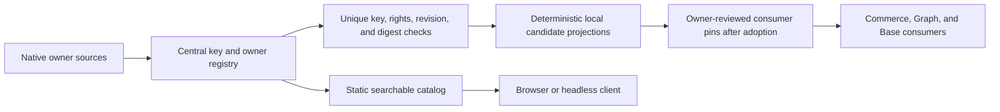

# Agentic Design System — Shared Ownership and Singleton Tokens

**Join:** `DESIGN-TOKEN-ADOPTION-001@0.9.0`, superseding `0.8.0`, `0.7.0`, `0.6.0`, `0.5.0`, `0.4.0`, `0.3.0`, and `0.2.0`. This revision records browser contrast and reduced-motion evidence for the local candidate. Actual browser UI 200% zoom remains unverified. The central registry candidate still contains Commerce, Base, and exact-grant Graph profiles; native component behavior remains with its product owner. Source rights, migration status, and runtime adoption are separate facts; this audit does not claim whole-repository centralization.

**Change boundary:** this successor starts from the published central candidate `a1c56f8ba3c3b8892897fcdbf6d61ed09784b6b7`. It binds `.agentic-os.json` to AOS's protected pull-request integration path and makes the public-release checker enforce that capability. Commit `6b60519f1f6e58053db02d83fd13ad0417940b2f` also removes loading-time copy swaps, defers below-fold status content until the catalog validates, and advances the offline cache version. The user granted public reuse of four exact Graph artifacts on 2026-10-29; that does not authorize other Graph sources or future revisions. No consumer migration, protected merge, catalog release, or deployment is claimed. The catalog and three profiles remain draft candidates.

## Codebase grounding record

Facts below were read from each exact `main` commit object, not inferred from another repository's working tree. File digests bind the inspected bytes; they are not permission or adoption receipts.

| Repository and revision | Exact source | Current owner and boundary | Evidence / consequence |
|---|---|---|---|
| `agentic-os` · `7b61883346a68db615317fe6e24c497be5a93bd7` | `guides/SYSTEM-PROMPT-RUNTIME.md` · SHA-256 `edfab6a19768c47508e7a6110d59216af9752821787129387826f4a2f1fc294f` | Runtime policy, lane admission, and release governance. It is not a visual-token source. | Keep governance and receipts with this owner; do not add product token values here. |
| `agentic-commerce-os` · `6ce3bc918717b97a738ac831dfb4fb3319a02fb6` | `public/local-first/workspace-shell.css` · SHA-256 `2e0b86c0efa040618b8cbfab9d130a751ab85e7d937f94762b8d523a5920f100`; `public/local-first/index.html` · SHA-256 `bff3aefecb745a23388b6a4cc85dd5ea285e84b8fb68dc18fe4619dcbe3d6429` | Commerce owns shell behavior, product state, and view-specific implementation. | Preserve the existing product owner and migrate only through a Commerce-scoped lane. |
| `agentic-graph` · `bed770d91a9b3f1b663eee9637a472bf19b36361` | Granted only: `grph-shared/src/ui/kgTokens.ts` · SHA-256 `4a8e7e57e011f986cc86d94f5d77d43cea26660627677cd5c0f4ab7fd25bc30e`; `grph-shared/src/ui/typography.ts` · SHA-256 `82d83deb9cba2ae5549069780e028849ee7365d46d97dff2574cdd1a00df8047`; `grph-shared/src/ui/fontStacks.js` · SHA-256 `27fe9d5fb35e866c662a28551162a3451604aea43b93ecaf7ba457cb8c356916`; generated `canvas/src/styles/kgTokens.generated.css` · SHA-256 `b676d411f7f1683a9b208b2a74f03a921d7e77a32a6f2b4a4274a41c6441dee8` | Graph remains owner of its source and runtime behavior. The user's 2026-10-29 grant allows only these exact values and generated CSS in this central MIT repository. | The central profile pins four exact files. Graph PR #1849 records the same grant; it is open and its docs-contract and Integration Gate checks pass. The repository's default private classification remains unchanged; no other Graph files or future revisions are granted. |
| `agentic-base` · `a5d0f2d87d8c6871e9639f8224f5eaee056c5b6e` | `packages/views-react/src/browser/browserDataView.css` · SHA-256 `f00b3f4c88dfa81946fdc1577aa01ff49ea3e6f996f32607bc715a5d93079b69` | Base owns the source and component behavior. | A 9-key profile and generated local CSS projection are central candidates. Base remains the native consumer and source owner until its own adoption and rollback lane completes. |
| `agentic-design-system` · `9dd6c3a98621aaebdf2a36187d3aa9272c27fbee` | `site/tokens/commerce-profile.json`, `site/tokens/base-profile.json`, `site/tokens/graph-profile.json`; deterministic profile modules and generated local CSS projections | This repository owns the draft catalog, profile contract, local projections, and discovery UI. | Commerce has 36 keys, Base 9, and Graph 69; all 114 candidate keys and CSS variables are unique in this registry. Candidate inclusion is not consumer adoption or a claim of cross-repository parity. |

The audited source revisions are the exact immutable Git objects listed above. Graph `origin/main` is `bed770d91a9b3f1b663eee9637a472bf19b36361`; the four granted artifact digests are pinned in the profile and owner-side PR. The validator checks the central Commerce, Base, and Graph profiles, license/permission evidence, generated local CSS, Commerce's consumer pin, and site-local declarations. It does not fetch moving refs or scan every declaration in all consumer repositories. Neither the source map nor these checks establish whole-repository parity or consumer migration.

The existing joined plan `DESIGN-TOKEN-ADOPTION-001@0.5.0` is the immediate predecessor; it supersedes `0.4.0`, `0.3.0`, and `0.2.0` and is not a parallel active plan. Its historical lineage is linked by the pinned `parent` above. The current plan's owner is this repository. A consumer plan or README may link here but may not restate token rules or create another authoritative registry.

## PRD

### Customer, pain, and evidence

**P1 — observed, not yet measured:** contributors lose time locating the owning token or style source across repositories. Repeated values and consumer overrides can drift, but time loss, defect rate, buyer impact, and willingness to pay have not been measured. Repository inspection confirms multiple native owners and generated files; it does not establish the number of duplicates or a customer outcome.

| Role | Job | Evidence state |
|---|---|---|
| Product contributor | Find one owner, key, and revision before changing a UI surface. | Intended user; interviews not run. |
| Source maintainer | Keep owned values consistent with the central registry and generated pin. | Owners observed; migration authority and rights remain to be verified. |
| Reviewer | See duplicate, override, rights, and compatibility gaps before release. | Existing checks cover only parts of this contract. |
| Buyer | Reduce recurring integration and review effort. | Buyer and willingness to pay are unknown. |

### Journey and scope

| Stage | User action | Desired result | Failure prevented |
|---|---|---|---|
| Need | Change a visual or interaction surface. | Resolve the canonical key and owning repository. | Copying a nearby value or choosing a stale variant. |
| Discover | Search the local catalog with plain text, `@owner`, or `#scope`. | One owner, source revision, digest, status, and consumer pin. | Duplicate records and mutable `latest` references. |
| Verify | Inspect source, rights, compatibility, and checks. | Pass, explicit gap, or blocked state. | Treating a screenshot, link, or generated file as source authority. |
| Adopt | Pin the owner and consume a deterministic local projection. | No runtime fetch and no second editable value. | Consumer override, duplicate stylesheet, or hidden cascade. |
| Maintain | Update the owner and regenerate consumers. | One reviewed successor with an exact predecessor. | Silent drift and competing registries. |

**Must:** one central owner registry; unique canonical keys; one editable design-system source per rights-cleared key and mode; exact source revision and digest; explicit rights and migration state; deterministic read-only projections; consumer pins and rollback targets; a fail-closed duplicate/override check; static, local, mobile, and offline discovery. The target state is that Commerce, Graph, and Base hold generated projections or contract-only adapters, not independent editable values. Rights-blocked inputs remain marked blocked and are not claimed centralized. The registry also records Agentic OS policy ownership; Agentic OS is not assigned visual tokens.

**Should:** local search by owner, concern, token key, and repository; copyable exact pins; drift status. **Could:** an opt-in preview from authorized sources. **Won't:** a second token source, consumer-authored overrides for registered keys, runtime network dependency, model calls, telemetry, account system, paid plan/add-on/overage, copied private components/assets, or a public rights claim inferred from repository visibility.

### Acceptance criteria

| VCC | Given / when / then | Named check | Constraint |
|---|---|---|---|
| DS-01 | A registry entry is loaded; it resolves to one canonical key, one owner, one source path, one immutable revision, and one digest or it is blocked. | `design-owner-registry-check` | Unknown ownership never defaults to a fallback source. |
| DS-02 | Two entries or declarations claim the same key or CSS variable; validation fails with both locations. | `design-singleton-enforcement-check` | Identical duplicate values also fail; no silent deduplication. |
| DS-03 | A consumer projection is generated from a pinned source; repeated generation is byte-stable and stale or hand-edited output fails. | `design-generated-output-check` | Generated outputs are read-only projections, never owners. |
| DS-04 | A consumer declares a different value for a registered key; the build rejects the override, including cascade-based overrides in the token layer. | `design-singleton-enforcement-check` | A new semantic key needs an owner and recorded decision; it cannot shadow an existing key. |
| DS-05 | A source has unknown or restricted reuse rights; it is visible as a blocked owner reference and no source value or asset is copied or publicly released. | `design-license-boundary-check` | Repository visibility is not a license. |
| DS-06 | The static catalog is opened on a clean 320px browser, then after cache priming without network; search and navigation remain usable. | `design-site-browser-check` | Local assets only; no CDN, remote font, telemetry, or runtime model call. |
| DS-07 | A reviewer checks keyboard, visible focus, contrast, 200% zoom, reduced motion, and narrow touch layouts; each has evidence or a named gap. | `design-accessibility-evidence-check` | A visual snapshot alone cannot pass behavior. |
| DS-08 | A consumer pin is rolled back; its prior exact revision and digest restore without deleting source history. | `design-rollback-check` | Rollback remains a consumer-owned operation with a separate receipt. |
| DS-09 | A contributor runs `npm run dev`; the local UI loads at the printed loopback URL and its network log shows no external requests. | `design-site-browser-check` | Dependency-free local server; no production deploy. |
| DS-10 | A machine client and read-only MCP/WebMCP transports read the same static registry as the browser; `/` sections, `#scope`, and `@owner` resolve to that record. | `design-catalog-contract-check` | No parallel registry or paid service; all transports join the same capability identity and handler. |

The static JSON contract and `site/registry-query.js` are the shared headless source. Local stdio MCP is implemented with newline-delimited JSON-RPC; the browser registers the same read-only capability names, input schemas, and handler through feature-detected `document.modelContext.registerTool()`. The checker exercises initialization, listing, calls, failures, schema parity, and a real child-process stdio exchange. A browser without `document.modelContext` retains static search; native WebMCP execution remains capability-gated and could not be exercised in the current browser.

### Outcomes and economics

| Measure | Baseline | Target |
|---|---|---|
| Resolve owner, revision, and status | Unknown; time five contributor tasks before baseline. | Median ≤5 minutes in a five-task pilot; report misses and correction loops. |
| Duplicate registered keys or token-layer overrides | Cross-repository inventory incomplete. | Zero unresolved duplicates or overrides in the declared candidate; do not claim whole-repository parity until every consumer is scanned. |
| Consumer pin coverage | Exact coverage not measured. | Every declared consumer points to one source revision and digest, or has an explicit blocked state. |
| Incremental spend / model use | Not attributable to this plan. | $0 spend and 0 product model calls/tokens. Unknown costs block an effect. |
| Time-to-value / savings | Unmeasured. | Report elapsed time and corrections; no savings claim before a comparable baseline. |

The first-dollar path to validate is a voluntary one-time US$1 sponsorship with no feature gate or recurring charge. No payment flow, outreach, paid plan, add-on, or overage is in the MVP; no collected revenue is claimed. Product and registry remain FOSS/free. Hosting allocation and labor cost remain unknown until measured.

### Market, offer, and alternatives

Initial segment hypothesis: small product teams maintaining browser interfaces across several repositories. The reachable buyer count, sales cycle, repeat demand, and price are unknown. The free/manual alternative is repository search and owner documentation; the FOSS alternative is a local schema and duplicate check. The MVP improves that workflow without a hosted service. Do not publish a monetary market estimate or forecast until segment fit and collected-price evidence exist.

## TAD

### Ownership and interfaces

| Concern | Authoritative owner | Consumer contract |
|---|---|---|
| Lifecycle policy, source admission, and release evidence | Agentic OS | Consumers reference its current policy; product design data stays out of this repository. |
| Shared design semantics, canonical keys, owner map, rights state, versioning | Agentic Design System | One record per candidate key and mode; immutable owner revision and digest. |
| Commerce theme values | Agentic Design System candidate profile; Commerce remains the live consumer owner | Existing Commerce CSS digest is pinned; Commerce behavior and migration remain Commerce-owned. |
| Graph theme values | Graph source; this repository holds a candidate snapshot of the four exactly granted artifacts | Graph's native runtime remains unchanged; the central projection has no Graph consumer pin or adoption receipt. |
| Base data-view values and component behavior | Base source; this repository holds a candidate profile of its licensed values | Base's native runtime remains unchanged; the central projection has no Base consumer pin or adoption receipt. |
| Browser behavior, data state, and product content | Each product repository | Keep native component APIs and state; consume design tokens through one adapter. |
| Generated CSS and local indexes | Generator bound to the central registry and exact source pins | Read-only output with reproducible digest; edits fail validation. |

**Registry record:** stable key; semantic scope; mode set; one owner repository/path; immutable revision; source digest; rights state; migration state; generated consumer paths and digests; compatibility; rollback pin; named checks. A key may have explicit mode values in one record, but no alternate file or cascade override. Product-specific concerns use new, non-overlapping keys and cannot redefine a shared key. An unresolved owner or rights state blocks publication and adoption.

### Data and invocation flow

The catalog reads local JSON. Future adopted consumers will pin static generated files and will not fetch the registry at runtime; the current central candidate does not change Graph or Base consumers. User-facing search supports plain text, `@owner`, and `#scope`; `/` resolves local section navigation. Read-only stdio MCP and feature-detected WebMCP expose the same capability names, schemas, and handler from `site/registry-query.js`. Discovery remains local and zero-token; a gateway may federate existing owner tools but this repository must not add a parallel registry or authority path.

### Quality, security, and operation

The site must reflow at 320, 360, 768, and 1280 CSS px without page-level horizontal overflow. Interactive targets are at least 44 CSS px; text contrast is at least 4.5:1 (large text 3:1), and control/focus contrast is at least 3:1. Current candidate verification covers 320, 360, 640, 768, and 1280 CSS px for page overflow and ten visible control targets. Keyboard search/focus, reduced-motion emulation, and browser-computed text/control contrast have been checked. Actual browser UI 200% zoom and repeatable/manual accessibility review remain gaps. Evidence and limits are listed in the implementation audit below.

Threats are duplicate keys, poisoned or stale owner metadata, digest drift, cascade overrides, rights leakage, incompatible projection, and a false rollback. Validate bounded JSON, render text safely, reject unknown fields, keep private/restricted content out of the public payload, and preserve a verified predecessor. The site has no user accounts, remote data service, analytics, or model calls.

**Budgets:** $0 incremental external spend; no paid dependency or model token; ≤25 changed paths across the plan's first implementation slice; ≤100 kB incremental shipped bytes; ≤3 new runtime modules; each file under 600 lines; one owner registry, one validator, one generator path. Stop at a cap and revise the plan before widening scope. External waits are blockers with an owner and recheck condition, not an ETA.

### Protected integration profile

The repository profile must select `protected-integration:pull-request` whenever release uses AOS `land` and `promote plan|apply`. The local `land` command must project the exact same-repository PR for the published head and protected base; the promotion plan must bind that PR, head, base, selected Integration Gate run, and squash method. The public-release check requires the capability and a valid profile digest. Do not select strict-base, merge-queue, or merge-method protection unless the live provider observation proves that policy. The profile change grants no merge authority.

The provider currently reports an Integration Gate check but no required pull-request rule. Therefore the profile successor can be prepared and locally verified, but protected publication/promotion remains blocked until repository authority applies a matching PR rule. This plan does not change provider settings or close the predecessor PR.

## ADR-01 — Central registry, native source owners, generated consumers

**Status:** proposed. **Decision:** make this repository the sole registry and, after rights-cleared migration, the sole editable value owner for adopted visual tokens across the product repositories. A migration records the current source as provenance, moves the value into the central source, and removes the old editable definition in the same owner-reviewed adoption. Generated consumer files are projections only. No product can override a registered key. If source rights or owner approval blocks transfer, keep one native source, mark the key blocked, and do not claim the centralization is complete.

**Alternatives:** leave four unindexed registries (retains discovery and drift pain); copy all values into the public catalog immediately (rights and exposure not established); impose one global palette without a mapped semantic owner (collapses product meaning). The chosen path centralizes governance now and migrates values only when owner and rights evidence permit it.

**Consequences:** duplicate definitions fail closed; product adapters may remain only as contract-only shims; a consumer migration is incomplete until the prior editable value is removed and generated pin is verified. Restricted values stay native and are represented only by a non-sensitive blocked reference.

## MVP

**Bounded implementation slice:** add the central ownership/key contract, source map for four repositories, three pinned candidate profiles, fail-closed global key and local declaration checks, deterministic Base/Graph CSS projections, local ownership/search UI, shared read-only MCP/WebMCP contract, a dependency-free `npm run dev` loopback server, and the AOS protected pull-request profile binding. The catalog and profiles stay draft. Consumer migrations remain owner-scoped and are not part of this slice.

| VCC set | Evidence | Local rung | Delivered rung |
|---|---|---|---|
| DS-01–DS-10 | The bounded central candidate and local invocation slice is implemented. DS-01, DS-03, DS-05, DS-06, and DS-09 pass within their declared local boundaries; DS-02 and DS-04 are partial because no full consumer scan ran; DS-07 and DS-10 retain the evidence gaps below; DS-08 has no consumer rollback receipt. | dev-proven | undocumented |

### Implementation completion audit · 2026-10-30

Audit surface: authoring lane `agent/device-0232231d4a19/design-system-registry`, candidate `6b60519`, base `9dd6c3a98621aaebdf2a36187d3aa9272c27fbee`. The checks below ran locally on this lane. A local result does not establish protected integration or delivery.

| VCC | Status | Evidence Reference | Remaining limit |
|---|---|---|---|
| DS-01 | Pass within declared candidate registry | `npm run check:design-system` validates four source owners and three revision/digest-pinned candidate profiles (Commerce 36, Base 9, Graph 69). The exact source objects and the four granted Graph file digests were independently verified. | The checker does not fetch external moving refs or validate all source declarations and consumers; owner freshness and cross-repository parity remain separate work. |
| DS-02 | Partial | `design-singleton-enforcement-check` validates 114 unique candidate keys/CSS variables; duplicate-key, duplicate-variable, and override fixtures fail; the site scan checks 145 central owner/projection declarations. | It does not scan every declaration in Commerce, Graph, or Base. Cross-repository singleton status remains unproven. |
| DS-03 | Pass for central projections and the existing Commerce pin | `design-generated-output-check` confirms the Base and Graph generated CSS projections match their profile digests and Commerce CSS matches its consumer pin. | Graph and Base have no central consumer pins or adoption receipts; source-owner regeneration and consumer rollback are not demonstrated. |
| DS-04 | Partial | The registry checker rejects a conflicting declaration in its site fixtures and scans site CSS/HTML/JS for Commerce variables. | It does not scan consumer cascade layers or all product declarations; consumer override prevention remains unproven. |
| DS-05 | Pass for declared rights boundaries | `design-license-boundary-check` verifies the central/Base and Commerce MIT evidence plus the exact four-file Graph grant. The Graph repository's default private classification remains in force outside those four files. Graph PR #1849 records the grant; its docs-contract and Integration Gate checks pass, and the PR remains open. | No other Graph source or future revision is cleared. Owner-record integration is still pending. |
| DS-06 | Pass for the local static candidate | At `http://127.0.0.1:4173/`, widths 320, 360, 640, 768, and 1280 CSS px had matching document/body widths; visible controls remained at least 44 CSS px high. Keyboard search for `#shared-data-view` returned one owner, one profile, and nine keys. Mobile and desktop Lighthouse each passed all 54 audits, including zero cumulative layout shift on desktop and 0.005 CLS on mobile. An offline reload after cache priming served all seven owner/profile cards from service-worker cache r7; resource origins remained loopback-only. | This is browser-session evidence, not a repeatable automated browser gate. Offline proof covers only the primed local cache and does not prove deployed behavior. |
| DS-07 | Partial; browser UI 200% zoom remains open | Keyboard search and focus visibility passed. Browser-computed contrast across visible text had a minimum of 5.77:1; the focus ring measured 7.47:1 against the page and 8.04:1 against the search surface; the search border measured 3.10:1 against white. With `prefers-reduced-motion: reduce`, the query matched and input animation/transition durations resolved to 0.00001 seconds. Visible targets remained at least 44 CSS px across the tested widths. | The computed color pass and reduced-motion emulation are browser-session evidence, not a repeatable CI gate. Actual browser UI 200% zoom remains unverified. |
| DS-08 | Not implemented | No consumer rollback or rollback receipt exists in this lane. | Requires an owner-scoped consumer pin rollback and verification of its exact predecessor revision/digest. |
| DS-09 | Pass | `npm run dev` printed `http://127.0.0.1:4173/`; the page and local profile/catalog/script/favicon resources returned HTTP 200. Resource origins remained loopback-only. The server binds only `127.0.0.1`, uses a strict file allowlist, and has zero declared runtime dependencies. | No production deployment is implied. |
| DS-10 | Partial; shared read-only contract passes | `npm run check:design-system` verifies browser query fixtures, WebMCP stub registration, equal MCP/WebMCP names and schemas, and a real stdio MCP initialize/list/call exchange. The live browser correctly reports that WebMCP is unavailable and keeps search active. | Native WebMCP execution could not be tested because this browser exposes no `document.modelContext`; verify on a supporting browser before claiming native browser-tool execution. |

Additional local evidence at predecessor head `a1c56f8ba3c3b8892897fcdbf6d61ed09784b6b7`: `npm run check:design-system`, `node scripts/check-public-release.mjs`, and `git diff --check` passed. The live AOS `land` recheck reported `no pull-request integration capability selected`; `.agentic-os.json` did not bind the PR route, leaving the lane projection's PR number null. `queue show` confirmed that the current provider requires the Integration Gate but has no required pull-request rule; provider policy is a separate repository-authority action. The site contains 86,812 bytes across 13 files; predecessor lane has 24 changed paths; the largest changed file is 563 lines; runtime-module additions are within the three-module budget when build-time profile generators are excluded. `package.json` declares zero dependencies. Incremental external spend and product model calls are $0 and 0. No production audit or deployment was run.

**Audit result:** the bounded central registry/UI slice is `dev-proven`; the joined product is not `runtime-ready`. Three central candidate profiles are present and exact source rights are recorded, but Base and Graph remain native consumers and Commerce has no completed migration. Cross-repository duplicate/override scanning and consumer rollback are absent; native WebMCP execution, manual contrast review beyond computed values, actual 200% browser zoom, a repeatable accessibility gate, and the five-task user pilot remain incomplete. No whole-repository parity, savings, buyer demand, protected merge, release, or deployment is claimed.

**Demo:** search a canonical key → inspect its one owner, revision, rights, and consumer pins → show a duplicate or override as blocked → follow the local predecessor pin. Target ≤3 minutes; timed pilot not run.

### Roadmap

| Phase | Rank / reuse | Exit | Stop and recovery |
|---|---|---|---|
| A · registry baseline | P1, unvalidated; reuse the existing static catalog and exact owner-source pins. | Four owner references and rights states grounded; Commerce, Base, and exact-grant Graph candidates verified. | Keep every profile draft until its consumer lane and owner receipt are complete. |
| B · central contract and UI | Reuse existing local assets, schema, and search; zero paid dependencies. | Local search, 114-key singleton fixtures, read-only MCP, WebMCP adapter, offline UI, and strict public-file check are implemented; DS-02/04, DS-07, and native WebMCP evidence remain partial. | Keep the catalog draft; do not claim all-repository singleton coverage without owner-scoped consumer checks. |
| C · consumer projections | Reuse each native generator and owner workflow. | Requires an owner-scoped plan/lane per consumer, pinned generated output, removal of the old editable value, and DS-03/04/08 evidence. | Graph grant covers only the four exact profile artifacts; owner-record PR #1849 remains open. Commerce/Base/Graph adoption requires separate migration and rollback evidence. |
| D · accessibility and value | Reuse browser and accessibility evidence; run five contributor tasks. | Actual 200% browser UI zoom, repeatable accessibility checks, and measured lookup/correction baseline. | Report gaps; do not claim parity or savings. |

**Next bounded action:** open owner-scoped consumer lanes for cross-repository duplicate/override checks, then migrate only rights-cleared keys with predecessor pins and rollback receipts. **Owner:** each consumer repository owner. **Prerequisites:** a fresh START-bound plan/mission and scoped adoption receipt per consumer; Graph values are centrally permitted only for the four exact source artifacts. **Estimate:** no ETA until those owner decisions and lane receipts exist. **Caps per lane:** ≤25 paths, ≤100 kB shipped delta, ≤1 new runtime module, <600 lines/module, $0 spend, 0 model tokens. **Completion check:** each consumer independently rejects duplicate/override fixtures and proves generated output, predecessor rollback, and protected integration. **Recheck trigger:** consumer owner grants a scoped lane; native WebMCP test reopens when the browser exposes `document.modelContext`.

### ADLC boundary

This is an authoring-lane implementation audit, not an Integration Receipt or deployment receipt. The predecessor lane `agent/device-0232231d4a19/design-system-registry` is published at `a1c56f8ba3c3b8892897fcdbf6d61ed09784b6b7`; PR #5 is open at that exact head and the protected base is `9dd6c3a98621aaebdf2a36187d3aa9272c27fbee`. AOS `land` did not project the PR because the predecessor profile omitted `protected-integration:pull-request`. This successor adds that profile capability and enforces it in the public-release check. The live provider does not yet require PRs, so this successor does not claim a successful provider handoff, merge, release, or deployment; PR #5 remains open pending separate disposition. RELEASE, deploy, runtime readback, rollback, and cleanup receipts remain separate; the product deploy owner has not been identified in this plan.

## GTM

| Rank | Segment / offer hypothesis | Evidence and next check |
|---|---|---|
| 1 | Teams with repeated multi-repository token drift; free/FOSS local registry and adoption checks. | Unvalidated. Time five tasks and interview maintainers only under separate outreach authority. |
| 2 | Voluntary one-time US$1 sponsorship with no feature restriction. | Hypothesis only; no payment request or collection in this scope. |
| 3 | Hosted catalog or recurring support tier. | Excluded until repeated use, cost, rights, and willingness to pay are measured; no paid plan/add-on/overage in this MVP. |

No revenue, market size, ROI, or time savings are claimed. Revenue and buyer evidence are separate from source integration and browser acceptance.

## C01–C16 coverage

**Join:** `DESIGN-TOKEN-ADOPTION-001@0.9.0` · **Owner:** Design-system product function · **As of:** 2026-10-30. **0:** four source owners are grounded at exact revisions; drift pain and willingness to pay are not measured. **1:** resolve one key to one owner and pin in ≤5 minutes in a five-task pilot; observation not run.

| Domain | Disposition | Evidence / gap | Owner and next check |
|---|---|---|---|
| C01 Purpose, customer, pain | covered | P1 discovery/drift hypothesis; interviews absent. | Product · time five tasks before baseline. |
| C02 Market, timing | covered | Segment and buyer count unknown. | Product · source fit before sizing. |
| C03 Offer, alternatives | covered | Free/manual and FOSS alternatives identified; WTP unknown. | GTM · test after repeated use. |
| C04 Product, experience | covered | Local responsive/offline/search/section evidence recorded; shared MCP/WebMCP contract passes; native WebMCP support and actual zoom remain open. | UX · close DS-07/10. |
| C05 Architecture, data | covered | Four owners grounded; Commerce consumer CSS pin and Base/Graph candidate projections recorded; only central/site-local uniqueness is proven. Base/Graph consumers have no central pins. | Architecture · DS-01/03/04. |
| C06 Quality, security, AI | covered | Commerce/Base MIT evidence, exact Graph file grant, local/offline evidence, and $0/no-model boundary are recorded; Graph's broader source classification remains private. | Security · DS-05/06. |
| C07 Decisions, tradeoffs | covered | Central governance, native owners, generated consumers selected. | Architecture · review ADR-01 after inventory. |
| C08 Smallest validated slice | covered | Registry, partial singleton checks, local UI, and loopback dev server are dev-proven. | Product · close DS-01–DS-04/10. |
| C09 Acquisition, retention | covered | Five-task discovery; no channel or repeat-use evidence. | GTM · observe pilot. |
| C10 Operations | covered | Commerce pin and local/offline checks exist; no consumer rollback receipt or protected release evidence exists. | Operations · DS-03/08. |
| C11 Organization, obligations | covered | Native owner and rights gates recorded; legal review open. | Product · resolve before public release. |
| C12 Financial viability | covered | $0 spend target; labor/hosting allocation unknown. | Finance · record actual cost only. |
| C13 Capital, milestones | covered | No funding or recurring offer; optional $1 sponsorship untested. | Product · no collection in MVP. |
| C14 ADLC execution | covered | Predecessor PR #5 is open and green, but its lane record has no PR binding because the repository profile did not select pull-request integration. This successor binds that capability; the provider must separately require PRs before AOS publication/promotion can pass. No merge/deploy authority is inferred. | ADLC owner · obtain repository-authority PR-rule evidence, then rerun `land` and prepare exact promotion plan. |
| C15 Audience projections | deferred | No validated buyer or financial inputs. | Product · revisit after pilot and WTP evidence. |
| C16 Learning, next increment | covered | Five-task baseline remains unmeasured; next increment is cross-source conformance and owner-scoped migrations. | Product · record pilot and same-plan successor after evidence. |

**Coverage:** 16/16 dispositioned; 15/15 applicable covered; 1 deferred; 0 not applicable. Revisit at baseline, MVP acceptance, and audience handoff; unknowns remain gaps.

## Evidence and references

- PRD/TAD/ADR/MVP/GTM guidelines 3.4.0 · SHA-256 `8f0eda9aaf4d0b1e2bcc7388e15d19d95e6ba88fe158dbbbb53c2c0d4225d87a`.
- Core templates 1.5.0 · SHA-256 `862369425974a704529164c02973a7ccb98b94d9a4eea73e347c8b4b57aa7966`.
- MCP transport contract · [official specification, 2025-11-25](https://modelcontextprotocol.io/specification/2025-11-25/basic/transports) · local stdio uses newline-delimited JSON-RPC; no HTTP service is needed for this slice.
- WebMCP contract · [Web Machine Learning Community Group draft](https://github.com/webmachinelearning/webmcp/blob/main/index.bs) and [Chrome for Developers guidance](https://developer.chrome.com/docs/ai/webmcp/) · progressive enhancement and API support remain browser-dependent.
- Predecessor plans `DESIGN-TOKEN-ADOPTION-001@0.3.0` and `@0.2.0` · exact path and revision in `parent`.
- Local implementation audit and evidence are recorded in the MVP section above; predecessor source SHA is `a1c56f8ba3c3b8892897fcdbf6d61ed09784b6b7` and the original protected base is `9dd6c3a98621aaebdf2a36187d3aa9272c27fbee`.
- Source commits, paths, and file digests in the Codebase Grounding Record; all are inspection evidence only.
